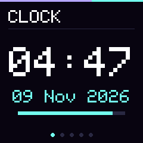
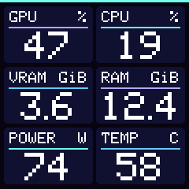

# GeekMagic CubicOS

**Открытая прошивка для GeekMagic HelloCubic‑Lite с экраном 240 × 240 и оптической призмой.** Кубик показывает время, нагрузку ПК, музыкальный спектр и погоду. Экранами и оформлением можно управлять из браузера в локальной сети.

[Скачать прошивку](https://github.com/turbovanya/GeekMagic-CubicOS/releases/latest) · [Первый запуск](#первый-запуск) · [Подключить ПК](#подключение-пк) · [Разбор платы и источники](#разбор-платы-и-источники)

<p align="center">
  
  
  <br><sub>Кадры с кубика. На экране ПК показаны тестовые значения.</sub>
</p>

| Экран | Что показывает |
| --- | --- |
| **Часы** | Крупное время, дата и шкала секунд. Два варианта циферблата. |
| **Компьютер** | Загрузку GPU и CPU, занятую VRAM и RAM, мощность и температуру GPU. |
| **Музыка** | Спектр из 16 полос. Аудиофайл воспроизводится в браузере, кубик получает уровни частот. |
| **Погода** | Текущую температуру, влажность и описание погоды от скрипта на ПК. |
| **О кубике** | Версию прошивки, имя точки доступа, её пароль и локальный IP. |

В **CubicOS Studio** можно выбрать одну из четырёх палитр, настроить яркость и автосмену экранов, задать смещение от UTC и снять кадр с дисплея.

## Первый запуск

Эта сборка предназначена для **HelloCubic‑Lite с ESP8266, 4 МиБ Flash и ST7789 240 × 240**. Если на кубике уже стоит CubicOS, перейдите к [обновлению по Wi‑Fi](#обновление-по-wi-fi-ota).

1. Скачайте файл `GeekMagic-CubicOS-0.5.1.bin` из [релиза v0.5.1](https://github.com/turbovanya/GeekMagic-CubicOS/releases/tag/v0.5.1) и установите [esptool 5](https://docs.espressif.com/projects/esptool/en/latest/esp8266/installation.html).
2. Найдите сигналы `TXD0`, `RXD0`, `GPIO0` и `GND` на своей ревизии платы. При отключённом питании подключите USB–UART с логикой **3,3 В**. Соедините земли, TX адаптера подключите к RX кубика, RX адаптера к TX кубика. Кубик запитайте через USB‑C, оставив вывод питания UART свободным.
3. Для входа в загрузчик удерживайте `GPIO0` на земле при включении кубика. Затем отпустите `GPIO0` и выполните команды ниже. Замените `COM3` на свой порт. В Linux это может быть, например, `/dev/ttyUSB0`. [Режим загрузчика ESP8266](https://docs.espressif.com/projects/esptool/en/latest/esp8266/advanced-topics/boot-mode-selection.html)
4. Сначала проверьте, что `flash-id` определяет **4 MB**, и прочитайте полную резервную копию. Проверьте, что файл копии имеет размер **4 194 304 байта**, прежде чем переходить к записи.

```sh
esptool --chip esp8266 --port COM3 --baud 115200 --before no-reset --after no-reset --no-stub flash-id
esptool --chip esp8266 --port COM3 --baud 115200 --before no-reset --after no-reset-stub read-flash 0x0 0x400000 hellocubic-backup.bin
```

После проверки резервной копии запишите прошивку и проверьте запись. [Команды esptool](https://docs.espressif.com/projects/esptool/en/latest/esp8266/esptool/basic-commands.html)

```sh
esptool --chip esp8266 --port COM3 --baud 115200 --before no-reset --after no-reset-stub write-flash 0x0 GeekMagic-CubicOS-0.5.1.bin
esptool --chip esp8266 --port COM3 --baud 115200 --before no-reset --after no-reset-stub verify-flash 0x0 GeekMagic-CubicOS-0.5.1.bin
```

Снимите перемычку `GPIO0 → GND`, если она ещё подключена, и перезапустите кубик через USB‑C. Резервная копия может содержать настройки вашей сети, поэтому храните её локально.

### Настройка домашней сети

1. На дисплее найдите имя точки доступа `CubicOS-…` и её пароль. Подключитесь к этой сети с телефона или ПК.
2. Откройте [настройку Wi‑Fi](http://192.168.4.1/wifi). Для входа используйте `admin` и пароль точки доступа с дисплея.
3. Нажмите **«Найти сети»**, выберите домашнюю сеть **2,4 ГГц** и введите её пароль. Для скрытой сети введите имя вручную.
4. После подключения переключите ПК или телефон обратно на домашнюю сеть. Откройте IP, показанный на экране **Device**, или используйте имя `cubicos-<id>.local`, если в вашей сети работает mDNS.

Для настройки часов откройте **«Конструктор оформления»** в CubicOS Studio и задайте смещение от UTC в минутах. Например, для UTC+3 это `180`.

### Обновление по Wi-Fi (OTA)

1. Скачайте BIN для HelloCubic‑Lite из [релизов](https://github.com/turbovanya/GeekMagic-CubicOS/releases).
2. В панели кубика выберите **«Обновить прошивку»** или откройте `/update` по его локальному адресу. Войдите как `admin` с паролем точки доступа CubicOS.
3. Выберите BIN в поле **Firmware** и дождитесь перезапуска. Кубик подхватит сохранённые настройки сети и дисплея. Проверьте версию на главной странице Studio или в `/api/status`.

## Подключение ПК

Выполните команды из корня репозитория. Здесь `192.168.1.50` — пример. Укажите адрес своего кубика.

```sh
python -m pip install psutil nvidia-ml-py
python tools/pc_metrics.py --host 192.168.1.50
```

В CubicOS Studio выберите экран **«Компьютер»**. По умолчанию данные обновляются каждые 1,5 секунды. Нажмите `Ctrl+C`, чтобы остановить передачу. Скрипт читает данные GPU через NVIDIA NVML. Если драйвер не отдаёт показание, на соответствующей карточке будет `--`. Занятая память отображается в ГиБ.

Если отправитель уже запущен, перезапустите его с обновлённым `tools/pc_metrics.py`, чтобы передавать все шесть показаний. Старые отправители продолжают работать. Их значение RAM отображается в процентах.

### Музыка и погода

Для спектра выберите аудиофайл в Studio и нажмите воспроизведение. Для погоды запустите скрипт ниже. Подставьте адрес кубика и координаты нужного места. Название на дисплее задаётся латиницей.

```sh
python tools/weather_feed.py --host 192.168.1.50 --latitude 52.52 --longitude 13.41 --label Berlin
```

Скрипт получает данные у Open‑Meteo и передаёт их кубику по локальной сети. Для коммерческого использования погодного сервиса действуют условия поставщика. [Условия Open‑Meteo](https://open-meteo.com/en/terms)

## Сборка из исходников

```sh
git clone https://github.com/turbovanya/GeekMagic-CubicOS.git
cd GeekMagic-CubicOS
python -m pip install platformio==6.1.19
pio run
```

Готовый образ находится в `.pio/build/hellocubic_lite/firmware.bin`. Этот же файл подходит для UART по адресу `0x0` и для OTA в поле **Firmware**.

<details>
<summary>Локальное API</summary>

| Путь | Метод | Данные |
| --- | --- | --- |
| `/api/status` | GET | Версия, MD5 прошивки, активный экран, время работы и состояние сети |
| `/api/page` | POST | Поле формы `page` от 0 до 4 |
| `/api/metrics` | POST | JSON с `cpu`, `gpu`, `ram` (%) и `gpu_temp` (°C). Дополнительно `vram_mib`, `ram_used_mib` и `gpu_power_w`. Для недоступных показаний GPU передайте `null`. |
| `/api/spectrum` | POST | JSON с массивом `bands` из 16 целых чисел от 0 до 100 |
| `/api/weather` | POST | JSON с `place`, `temperature` (°C), `humidity` (%) и `code` (WMO) |
| `/debug/screen.bmp` | GET | Кадр 240 × 240. Пароль точки доступа скрыт. |

</details>

Прошивка рассчитана на доверенную локальную сеть. Настройки и обновление защищены HTTP Basic, управление экраном и приём данных доступны из локальной сети.

Версия 0.5.0 проверена на одном HelloCubic‑Lite. На устройстве проверены OTA, сохранение сети и оформления после перезапуска, поиск Wi‑Fi, захват кадра, метрики ПК и спектр из браузера. Экран погоды проверен на тестовых данных. Подключение к другим роутерам и аппаратным ревизиям требует дополнительной проверки.

## Разбор платы и источники

- **Times‑Z / GeekMagic‑Open‑Firmware** — проект, в котором разобрали HelloCubic‑Lite, исследовали подключение ST7789 и задокументировали параметры SPI и последовательность запуска дисплея. Эти материалы использованы при разработке драйвера CubicOS. [Репозиторий](https://github.com/Times-Z/GeekMagic-Open-Firmware) · [Разбор и описание дисплея](https://github.com/Times-Z/GeekMagic-Open-Firmware/blob/develop/readme.md#screen-hardware-configuration)
- Компоновка PC Metrics вдохновлена панелью системных показателей из [Times‑Z / GeekMagic‑Open‑Firmware #32](https://github.com/Times-Z/GeekMagic-Open-Firmware/pull/32).
- **GeekMagicClock / HelloCubic‑Lite** — руководство и заводские прошивки производителя. [Официальный репозиторий](https://github.com/GeekMagicClock/HelloCubic-Lite)

Лицензия проекта — [GPL‑3.0](LICENSE).
